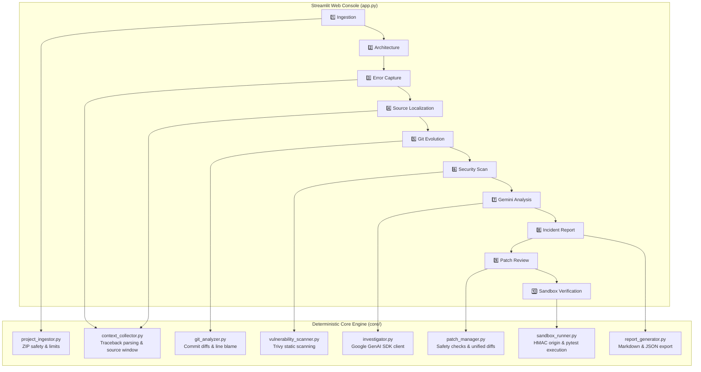

# 🕵️ PHANTOM: Evidence-Driven AI Software Incident Investigator

> **PHANTOM** is a deterministic, evidence-grounded incident investigation and remediation console that correlates runtime exceptions, source code context, Git historical evolution, and dependency CVE scans. It reasons about root causes using Google's official Gemini API (`gemini-3.8-flash`), generates safe localized diff patches, and verifies corrections in an isolated working copy bound by cryptographic HMAC origin validation.

---

## 1. Problem Statement & Purpose

When critical production services crash, engineers typically spend hours correlating error stack traces, hunting through recent commits, determining who introduced the offending logic, and verifying whether a proposed fix breaks existing behavior.

AI assistants often hallucinate:
- Blaming the latest commit on `HEAD` even when an earlier commit introduced the bug.
- Confusing the crash line (where Python threw an exception) with the true root cause line (where an invalid state or variable was assigned).
- Proposing full-file rewrites or hallucinatory code patches that break regression tests.
- Executing unverified user code that compromises the host server.

**PHANTOM solves this by:**
1. Grounding all AI analysis in deterministic repository facts (exact AST frames, diff hunks, Git blame, and Trivy CVE manifests).
2. Distinguishing crash location from root cause location.
3. Isolating the culprit commit without assuming `HEAD` introduced the bug.
4. Enforcing human-in-the-loop review with side-by-side snippet comparisons and unified diffs.
5. Strictly restricting test execution to trusted, path-bound sample repositories while maintaining static-only boundaries for untrusted user uploads.

---

## 2. Architecture & Module Descriptions



| Module | File | Purpose |
| :--- | :--- | :--- |
| **Project Ingestor** | [`core/project_ingestor.py`](core/project_ingestor.py) | Safely extracts uploaded ZIP archives with path traversal, symlink, and resource limit defenses (25MB compressed, 100MB uncompressed, 1000 files). Neutralizes executable `.git` hooks. |
| **Context Collector** | [`core/context_collector.py`](core/context_collector.py) | Deterministically parses multiline tracebacks, identifies the innermost project frame, and extracts source code windows with crash markers. |
| **Git Analyzer** | [`core/git_analyzer.py`](core/git_analyzer.py) | Inspects Git repositories, extracts unified diffs, runs line blame, and isolates the introducing commit vs. `HEAD`. |
| **Vulnerability Scanner** | [`core/vulnerability_scanner.py`](core/vulnerability_scanner.py) | Interfaces safely with Trivy (`C:\Tools\Trivy\trivy.exe`) via `shell=False` to scan dependency lockfiles without running setup or install scripts. |
| **Investigator** | [`core/investigator.py`](core/investigator.py) | Constructs structured evidence prompts and queries Gemini (`gemini-3.8-flash`) via the official `google-genai` SDK. |
| **Patch Manager** | [`core/patch_manager.py`](core/patch_manager.py) | Validates patch uniqueness, prevents whole-file replacements, renders unified diffs, and creates working copies. |
| **Sandbox Runner** | [`core/sandbox_runner.py`](core/sandbox_runner.py) | Executes Pytest with a 15s timeout, captured output, sanitized Windows environment, and HMAC-SHA256 origin validation. |
| **Report Generator** | [`core/report_generator.py`](core/report_generator.py) | Serializes complete incident records into downloadable Markdown and JSON documents, excluding all secrets. |

---

## 3. Windows Installation & Setup

### Prerequisites
- **Operating System:** Windows 10 / 11 (64-bit)
- **Python:** 3.11, 3.12, 3.13, or 3.14 (Verified on Python 3.14.3)
- **Git for Windows / MinGit:** Installed and available on system path or at `%LOCALAPPDATA%\Programs\MinGit\cmd\git.exe`
- **Trivy (Optional for Vulnerability Scanning):** Installed at `C:\Tools\Trivy\trivy.exe`

### 1. Clone & Set Up Python Environment
Open PowerShell:
```powershell
# Navigate to workspace
cd C:\Users\Afreen\OneDrive\Desktop\Phantom

# Create and activate virtual environment (optional but recommended)
python -m venv .venv
.\.venv\Scripts\Activate.ps1

# Install dependencies
pip install -r requirements.txt
```

### 2. Configure Gemini API Key
Create a `.env` file in the project root:
```ini
GEMINI_API_KEY=your_actual_gemini_api_key_here
GEMINI_MODEL=gemini-3.8-flash
```
*(Alternatively, you can input the API key directly into the Streamlit sidebar password field at runtime.)*

### 3. Configure Trivy Vulnerability Scanner (Optional)
Trivy 0.76.2 is supported for dependency scanning:
```powershell
# Set environment variable pointing to Trivy binary
$env:TRIVY_BIN = "C:\Tools\Trivy\trivy.exe"
```
*(If Trivy is not installed, PHANTOM's vulnerability scanning section displays a graceful unavailable message; all other 9 steps remain 100% operational.)*

---

## 4. Running the Application

Launch the Streamlit console:
```powershell
$env:TRIVY_BIN = "C:\Tools\Trivy\trivy.exe"
streamlit run app.py
```
The application will open in your default browser at `http://localhost:8501`.

---

## 5. End-to-End Hackathon Demo Sequence (Payment Service)

Follow this step-by-step reproducible script to demonstrate PHANTOM live:

### Step 1: Select Demo Incident
1. In the sidebar under **🎯 Demo Incident Loaders**, click **`💳 Payment Service (ZeroDivisionError)`**.
2. Notice that:
   - **STEP 1** selects `Payment Service Incident (ZeroDivisionError)`.
   - **STEP 2** displays 2 Python files, 1 Dependency file (`requirements.txt`), and active Git history (4 commits).
   - **STEP 3** populates the reproducible traceback:
     ```text
     Traceback (most recent call last):
       File "test_payment.py", line 42, in test_empty_batch_reconciliation
         summary = processor.reconcile_batch(batch_id="batch_empty", transactions=[])
       File "payment.py", line 114, in reconcile_batch
         avg_ticket = total_volume / len(settled)
     ZeroDivisionError: division by zero
     ```

### Step 2: Source Code & Git Evolution Analysis
1. Inspect **4️⃣ STEP 4**:
   - Innermost application frame identified at `payment.py:114` in `reconcile_batch`.
   - The culprit source code window highlights line 114:
     `>>> 114:         avg_ticket = total_volume / len(settled)`
2. Inspect **5️⃣ STEP 5**:
   - The **Historical Evidence Summary** reports that line 114 was introduced in commit `c3ab04e` (`feat: Add average ticket calculation to batch reconciliation`) by Marcus Ray.
   - Crucially, it highlights that `HEAD` commit `e4296c5` (`docs: Add method docstrings`) by Alice Dev did **not** touch line 114, avoiding false blame!

### Step 3: Run Optional Dependency Vulnerability Scan
1. In **6️⃣ STEP 6**, click **`🛡️ Run Dependency Vulnerability Scan`**.
2. Trivy executes a safe filesystem scan:
   - Returns **Clean Scan**: `No vulnerabilities were detected by this scan.`
   - Clarifies that zero CVEs were found in declared dependencies while disclaiming coverage boundaries.

### Step 4: Investigate Incident
1. Under **7️⃣ STEP 7**, click **`🚀 Investigate Incident`**.
2. PHANTOM evaluates the evidence:
   - If an API key is present: invokes Gemini 3.8 Flash live.
   - If no API key is set: displays the deterministic demonstration baseline with an explicit non-AI notice.
3. Review **8️⃣ STEP 8**:
   - Likely Root Cause: `reconcile_batch divides total_volume by len(settled) without guarding against an empty settled list`.
   - Confirmed evidence and Git history citations.
   - Honest confidence rating and model boundaries.

### Step 5: Review, Reject, and Apply Patch
1. In **9️⃣ STEP 9**:
   - Prominent banner: `⚠️ AI-GENERATED SUGGESTION — REVIEW REQUIRED`.
   - Side-by-side comparison of original code vs. corrected code:
     - Original: `avg_ticket = total_volume / len(settled)`
     - Proposed: `avg_ticket = (total_volume / len(settled)) if settled else 0.0`
   - Unified diff generated by Python's `difflib`.
2. Developer Actions:
   - Click **`🔍 Review Patch Details`** to mark status as `in_review`.
   - (Optional) Click **`❌ Reject Patch`** to demonstrate developer rejection (original files remain untouched).
   - Click **`✅ Apply to Working Copy`**:
     - PHANTOM creates an isolated temporary working copy (`phantom_working_copy_*`).
     - Applies the patch strictly to the working copy.
     - Confirms that the original repository at `samples/payment_service` has **ZERO** Git modifications.

### Step 6: Verify Regression in Sandbox
1. In **🔟 STEP 10**:
   - Because `samples/payment_service` is a controlled sample, the working copy possesses a valid path-bound HMAC-SHA256 origin manifest.
   - PHANTOM executes Pytest inside a sanitized Windows subprocess (15s ceiling).
   - Status updates to: **`✅ Verification Status: Tests passed.`** (5 passed, 0 failed in < 1s).
2. Contrast with Uploaded ZIP:
   - If an untrusted ZIP is uploaded, test execution is strictly blocked with the status: **`⚠️ Verification not performed: Arbitrary test execution is disabled for untrusted uploads.`**

### Step 7: Export Investigation Report
1. Scroll to **📥 Export & Download Incident Investigation Report**.
2. Click **`📄 Download Report (Markdown)`** or **`📊 Download Report (JSON)`**.
3. Download the structured incident dossier containing all evidence, blame records, scan findings, diffs, and verification metrics with all secrets excluded.

---

## 6. Security Boundaries & Safeguards

| Threat Vector | PHANTOM Defense Mechanism |
| :--- | :--- |
| **Malicious ZIP Archives** | Path traversal checks reject absolute paths and `..`. Symlinks are rejected. Resource limits: max 25MB compressed, 100MB uncompressed, 1000 files. |
| **Arbitrary Code Execution** | Uploaded project archives are strictly prohibited from test execution. Pytest is blocked; static analysis and patch generation only. |
| **Dependency Install Exploits** | PHANTOM never executes `pip install`, `setup.py`, `pipenv`, or dependency installation scripts. Trivy scans manifests purely statically. |
| **Subprocess Exploits** | Subprocess invocations use `shell=False`, explicit executable paths, captured streams, strict timeouts (15s for tests, 60s for Trivy), and minimal sanitized environments. |
| **Secret Exfiltration** | Subprocess environments filter against an allowlist and strip any variable containing `KEY`, `SECRET`, `TOKEN`, `AUTH`, or `PASS`. API keys are kept in-memory only. |
| **Manifest Replay Attacks** | Origin manifests are signed with HMAC-SHA256 binding `canonical_sample::target_abs` against an ephemeral in-memory server session secret. Replaying a manifest to another folder fails verification. |
| **Integrity of Originals** | Patches are never applied in-place to original projects. Modifications occur strictly within ephemeral working copies. |

> [!NOTE]
> **Boundary Disclaimer:** PHANTOM's working-copy isolation and HMAC origin validation provide robust application-level guardrails against accidental execution of untrusted user uploads. It is not an OS-level hypervisor, hardware virtualization, or kernel container sandbox.

---

## 7. Current Limitations

1. **Language Scope:** Focused specifically on Python runtime crashes and Pytest test suites.
2. **Dynamic Traceback Resolution:** C-extension exceptions without standard Python tracebacks provide limited frame localization.
3. **Repository Depth:** Git history analysis retrieves up to 10 recent commits per file to ensure responsive UI performance.
4. **Vulnerability Freshness:** Dependency scan accuracy relies on local Trivy vulnerability database freshness.

---

## 8. Verification & Test Suite

Run PHANTOM's automated test suite:
```powershell
$env:TRIVY_BIN = "C:\Tools\Trivy\trivy.exe"
python -m pytest tests -v
```

**Test Suite Breakdown (80 tests):**
- Ingestion & Archive Security: 9 tests
- Context Collector & Traceback Parsing: 10 tests
- Git History & Blame Correlation: 3 tests
- Patch Management & Unified Diff: 14 tests
- Sandbox Runner & HMAC Security: 11 tests
- Vulnerability Scanner (Trivy): 16 tests
- Investigator & Prompt Grounding: 8 tests (1 live API skipped when no key set)
- Payment Sample Integration & Report Generation: 7 tests
- Report Generator (Markdown & JSON): 2 tests
